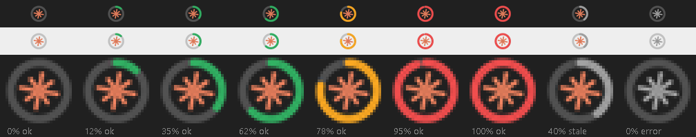
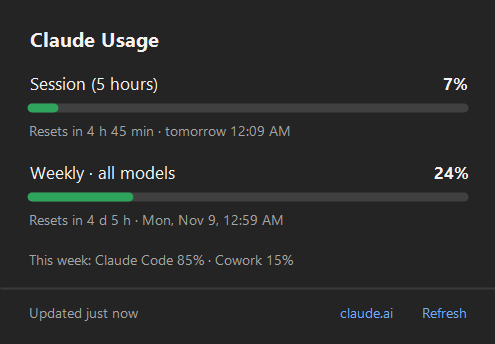

# Claude Usage System Tray

> Windows tray icon showing your Claude usage limits as a filling ring, with a details panel. Based on [apexlocal-jz/claude-usage-tray](https://github.com/apexlocal-jz/claude-usage-tray).

The icon is the Claude asterisk inside a ring that fills clockwise with your 5-hour session usage: green under 70%, amber under 90%, red at 90% and above, and gray when the data is more than 20 minutes old.



Click it to open a panel next to the icon with your session and weekly limits, when each one resets, and this week's usage by product. It follows the Windows light/dark theme and positions itself correctly with vertical taskbars.



Based on [apexlocal-jz/claude-usage-tray](https://github.com/apexlocal-jz/claude-usage-tray) by Joe Zeng. This version redesigns the icon and the details panel and adds a watchdog that restarts the app if it crashes.

> Unofficial tool, not affiliated with Anthropic. It uses an undocumented endpoint (`/api/oauth/usage`) that may change.

## Requirements

- Windows 10/11 with Windows PowerShell 5.1 (built in)
- Claude Code installed and signed in (`~/.claude/.credentials.json`)

## Install

1. Download the repository (Code → Download ZIP) and unzip it to a permanent folder, for example `C:\Users\<you>\.claude\usage-tray`.
2. In PowerShell:

   ```powershell
   powershell -NoProfile -ExecutionPolicy Bypass -File "C:\Users\<you>\.claude\usage-tray\Install.ps1"
   ```

This adds a shortcut to your Windows Startup folder and launches the app. To remove it, run `Uninstall.ps1` the same way.

## Privacy and network

- Reads the OAuth token that Claude Code maintains; it **never** refreshes or writes it. If the token expires, the app asks you to open Claude Code.
- Only calls `GET https://api.anthropic.com/api/oauth/usage`, about every 5 minutes. No telemetry.
- Stores `tray.log` and `last-usage.json` (your latest percentages) in its own folder.

## Files

| File | Purpose |
|---|---|
| `ClaudeUsageTray.ps1` | The app (icon, panel, API calls) |
| `Watchdog.ps1` | Restarts the app if it exits on an error; stops when you pick *Quit* |
| `Start.vbs` | Launches the watchdog with no visible window |
| `Install.ps1` / `Uninstall.ps1` | Startup shortcut, install and uninstall |
| `tests/Preview.ps1` | Renders `panel.png` and `icons.png` to review the design without touching the tray |

## License

MIT. See [LICENSE](LICENSE).
